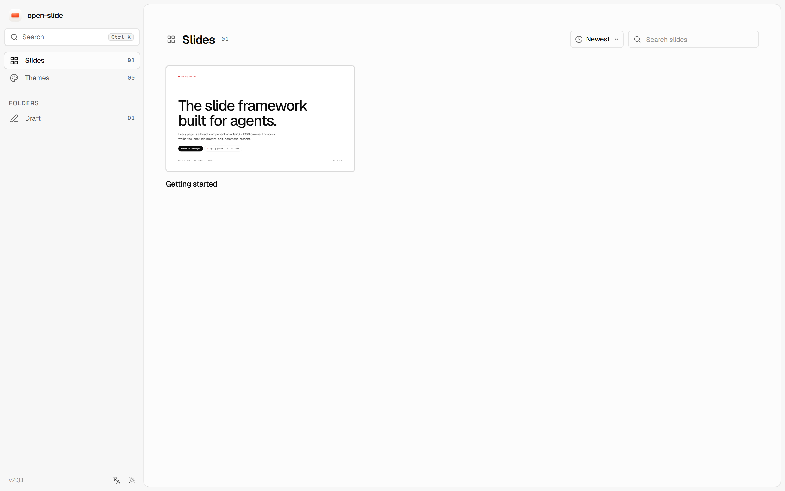
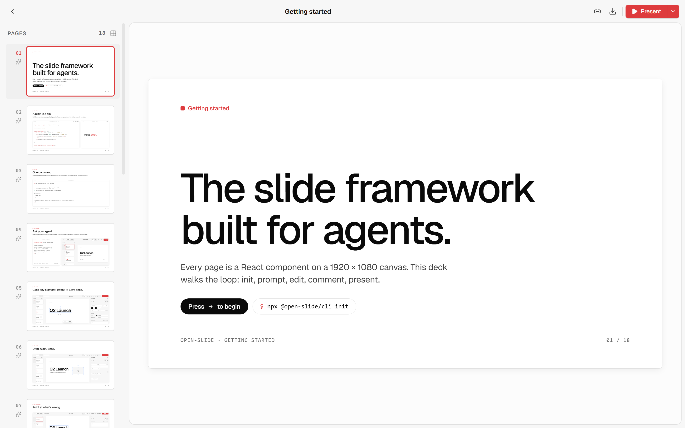
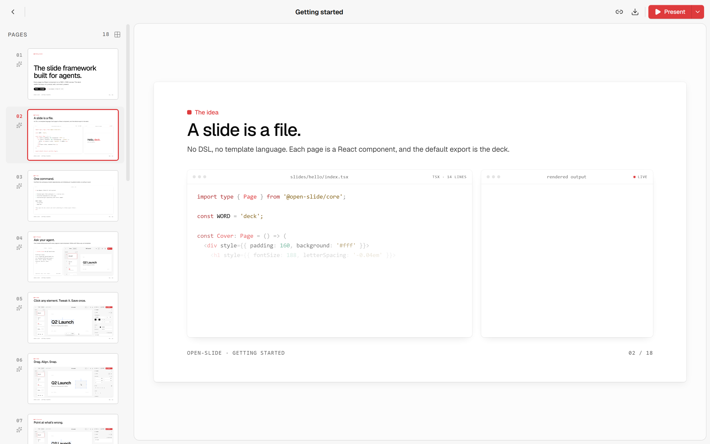
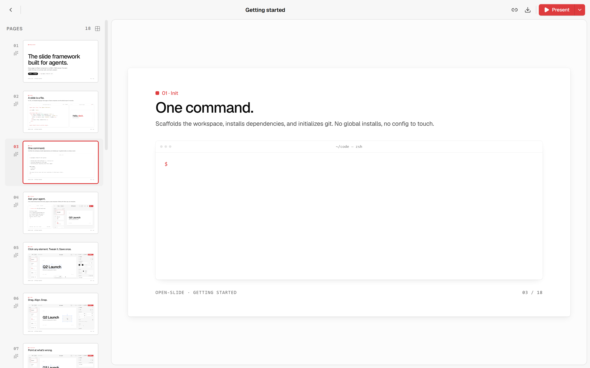
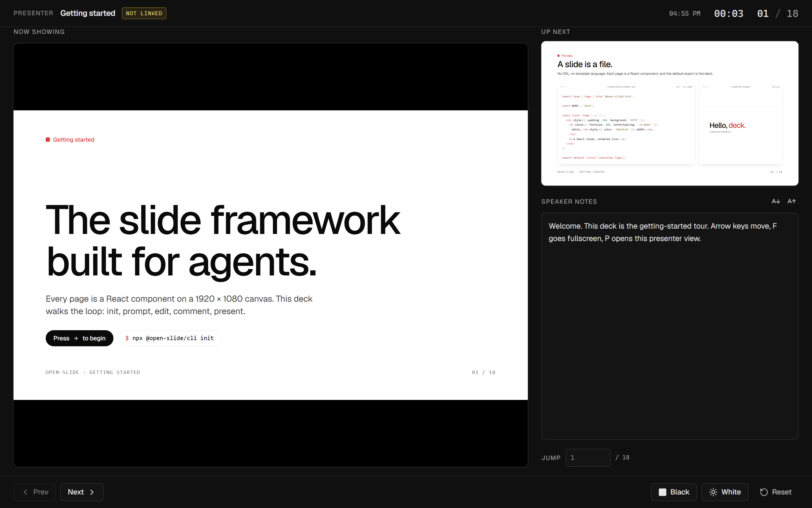

# open-slide workspace

Slides as React components. Each slide lives under `slides/<id>/index.tsx` and default-exports an array of page components. The `@open-slide/core` runtime handles layout, scaling, navigation, thumbnails, and fullscreen play mode — you just write the pages.

## Screenshots

### 1. Slide Library

The home screen lists all decks as thumbnail cards with sort and search controls. Each card previews the first slide of the deck at a glance — here showing the built-in **Getting started** tour (18 pages). The sidebar organises decks into folders and separates slide files from theme files, while a version badge and theme toggle sit at the bottom.



### 2. Slide Editor — Cover Page

Opening a deck reveals the full editor: a left rail of numbered page thumbnails (18 pages, each with an AI-action icon), a 1920 × 1080 canvas rendered at viewport scale, and a top bar with Present, Design, and Format controls. The canvas shows the cover page — a typographically bold title slide with a terminal install chip and a footer folio.



### 3. Page Navigation — Slide 2

Pressing → advances to page 2: "A slide is a file." Two macOS-style mock windows sit side by side — a syntax-highlighted `slides/hello/index.tsx` source file on the left and a live rendered-output preview on the right — demonstrating that every page is simply a TypeScript React component with no DSL or template language.



### 4. Page Navigation — Slide 3

Page 3 ("One command.") shows the project scaffold step with a dark terminal window mock. A `$` prompt demonstrates the `npx @open-slide/cli init` command that bootstraps the workspace, installs dependencies, and initialises git — no global installs, no config to touch.



### 5. Presenter View

The `/presenter` route opens the speaker control panel: the current slide on the left, the upcoming slide preview on the right, private speaker notes below (editable font size), a real-time elapsed timer, a jump-to-slide input, and Prev / Next / Black / White / Reset controls at the bottom. A `NOT LINKED` badge shows when no audience window is connected.



---

## Getting started

```bash
npm install
npm run dev
```

Then open the dev server and edit `slides/getting-started/index.tsx`, or create a new slide at `slides/<your-slide>/index.tsx`.

## Scripts

| Command | Description |
| --- | --- |
| `npm run dev` | Start the dev server with hot reload. |
| `npm run build` | Build a static bundle you can deploy. |
| `npm run preview` | Preview the built bundle locally. |

## Authoring a slide

```tsx
// slides/my-slide/index.tsx
import type { Page, SlideMeta } from '@open-slide/core';

const Cover: Page = () => (
  <div style={{ width: '100%', height: '100%' }}>Hello</div>
);

export const meta: SlideMeta = { title: 'My slide' };
export default [Cover] satisfies Page[];
```

Every page renders into a fixed **1920 × 1080** canvas — design with absolute pixel values. Put images, videos, and fonts under `slides/<id>/assets/` and import them directly.

See [`CLAUDE.md`](./CLAUDE.md) for the full authoring guide.

## Navigation

- Arrow keys / PageUp / PageDown move between pages.
- `F` enters fullscreen play mode; Esc exits.
- In play mode: Space / → next, ← prev.
- `P` opens the presenter view at `/s/<id>/presenter`.

## Agent integration

This workspace ships with agent skills preconfigured under `.claude/skills/` and `.agents/skills/`. Ask an agent to "make slides about X" and the `create-slide` skill takes over. Use `apply-comments` to iterate via inspector-style markers inside your source.

## Config

Optional `open-slide.config.ts` at the workspace root:

```ts
import type { OpenSlideConfig } from '@open-slide/core';

const openSlideConfig: OpenSlideConfig = {
  port: 5173,
};

export default openSlideConfig;
```

Supported fields: `slidesDir`, `port`.

```bash
pnpm install
pnpm dev
```

Then open the dev server and edit `slides/getting-started/index.tsx`, or create a new slide at `slides/<your-slide>/index.tsx`.

## Scripts

| Command | Description |
| --- | --- |
| `pnpm dev` | Start the dev server with hot reload. |
| `pnpm build` | Build a static bundle you can deploy. |
| `pnpm preview` | Preview the built bundle locally. |

## Authoring a slide

```tsx
// slides/my-slide/index.tsx
import type { Page, SlideMeta } from '@open-slide/core';

const Cover: Page = () => (
  <div style={{ width: '100%', height: '100%' }}>Hello</div>
);

export const meta: SlideMeta = { title: 'My slide' };
export default [Cover] satisfies Page[];
```

Every page renders into a fixed **1920 × 1080** canvas — design with absolute pixel values. Put images, videos, and fonts under `slides/<id>/assets/` and import them directly.

See [`CLAUDE.md`](./CLAUDE.md) for the full authoring guide.

## Navigation

- Arrow keys / PageUp / PageDown move between pages.
- `F` enters fullscreen play mode; Esc exits.
- In play mode: Space / → next, ← prev.

## Claude Code integration

This workspace ships with Claude Code skills preconfigured under `.claude/skills/` and `.agents/skills/`. Ask Claude Code to "make slides about X" and the `create-slide` skill takes over. Use `apply-comments` to iterate via inspector-style markers inside your source.

## Config

Optional `open-slide.config.ts` at the workspace root:

```ts
import type { OpenSlideConfig } from '@open-slide/core';

const openSlideConfig: OpenSlideConfig = {
  port: 5173,
};

export default openSlideConfig;
```

Supported fields: `slidesDir`, `port`.
